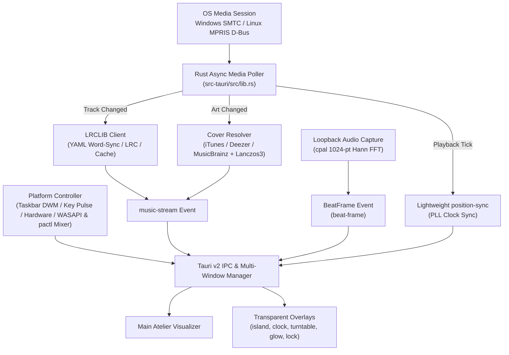

# Constellation Suite

Cross-platform desktop music visualizer, synced lyrics constellation, Dynamic Island companion, WebGL2 live shader stage, and ambient desktop utility suite built with **Tauri v2 (Rust + React 19 + TypeScript + Framer Motion + GSAP + WebGL2/GLSL)** under the **Obsidian Atelier** minimalist luxury design system.

## Download

Download the latest native installers directly from [GitHub Releases (v3.1.0)](https://github.com/Snowman-jeje/constellation-lyrics/releases/latest):

| Platform | Package | Download |
| :--- | :--- | :--- |
| **Windows (x64)** | NSIS Installer (`.exe`) | [Constellation Suite_3.1.0_x64-setup.exe](https://github.com/Snowman-jeje/constellation-lyrics/releases/download/v3.1.0/Constellation.Suite_3.1.0_x64-setup.exe) |
| **Linux (Debian / Ubuntu)** | `.deb` Package | [Browse v3.1.0 `.deb` on Releases](https://github.com/Snowman-jeje/constellation-lyrics/releases/tag/v3.1.0) |
| **Linux (Universal)** | `.AppImage` | [Browse v3.1.0 `.AppImage` on Releases](https://github.com/Snowman-jeje/constellation-lyrics/releases/tag/v3.1.0) |

All release binaries include `checksums-windows.txt` and `checksums-linux.txt` for SHA-256 verification, and the app checks for new releases automatically via the built-in updater.

## Features

- **5 Lyrics Renderers**: `Stars` (constellation canvas), `Lines` (smooth multi-row depth glide), `BigWords` (kinetic editorial serif with optional album art text mask), `Lens` (optical glass loupe), and `Depth 3D` (3D Z-corridor perspective where upcoming lyrics emerge from deep space into focal clarity with pointer tilt and beat pulse).
- **4 Backdrops & 12 Live WebGL2 Scenes**: `Black`, `White`, `Cover`, `Aura`, and `Live` featuring 12 procedural GLSL fragment shaders (`aurora`, `orb`, `sea`, `dream`, `fall`, `silk`, `shoal`, `veil`, `lane`, `tide`, `city`, `wall`) with pointer parallax and ambient Canvas 2D weather (`rain`, `snow`, `mist`, `stars`).
- **4 Beat Glow Styles**: `Rim`, `Edges`, `Corners`, and `Sides` driven by real-time WASAPI/Monitor loopback FFT beat detection (`Music` vs `Steady`) with customizable thickness, brightness, and custom dual colors.
- **Multi-Mode Dynamic Island**: Morphing pill supporting `Closed`, `Peek`, `Player`, `Big` (spinning vinyl + tonearm), `HUD`, `Weather` (Open-Meteo), `Timer` (with audio ducker), `Notes`, `Tasks`, and `Hardware` telemetry gauges across 3 glass looks.
- **Desktop Widgets & Ambient Lock Mode**: Draggable `Desktop Clock` (4 luxury faces), `Desktop Turntable`, fullscreen `Lock Mode`, webcam `Mirror`, mechanical `Key Sounds` (4 Web Audio synthesized profiles with non-logging timing hook) + `Typing Buddy`, per-app `Audio Mixer`, and Windows taskbar styling.
- **Smart Lyrics & Cover Pipeline**: LRCLIB client with studio YAML `lyricsfile` word-sync, LRC/plain fallback, and multi-source high-res cover art fallback (Apple iTunes, Deezer, MusicBrainz/CoverArtArchive) with pure-Rust Lanczos3 upscaling and dominant RGB palette extraction.
- **Built-in Auto-Updater**: Automatic startup & manual GitHub Releases SemVer update check with SHA-256 checksum verification (`checksums-windows.txt` / `checksums-linux.txt`) and one-click installer launch.
- **Minimalist Obsidian Atelier UI**: Icon-first controls, Double-Bezel machined glass containers, auto-hiding chrome on idle, and all 4 boundary states (Loading Skeleton, Empty State, Error Boundary, Toast).

## Backend & IPC Architecture



## Keyboard Shortcuts

- `Space`: Play / Pause
- `ArrowRight` / `ArrowLeft`: Next / Previous track
- `[` / `-` and `]` / `=`: Adjust lyric sync offset (`-0.2s` / `+0.2s`)
- `Ctrl+,`: Toggle Luxury Settings Hub
- `Ctrl+Shift+L`: Toggle Ambient Lock Mode
- `F11` or `F`: Toggle Fullscreen
- `Esc`: Close modal or dismiss Lock Mode

## Development & Building Installers

### Prerequisites
- Node.js 22+ and npm
- Rust stable toolchain
- Windows: WebView2 runtime (built into Windows 10/11) and NSIS (auto-fetched by Tauri CLI)
- Linux (Ubuntu/Debian):
  ```bash
  sudo apt-get update
  sudo apt-get install -y libwebkit2gtk-4.1-dev libayatana-appindicator3-dev librsvg2-dev patchelf libasound2-dev libdbus-1-dev libgtk-3-dev libssl-dev
  ```

### Run in Development
```bash
npm --prefix frontend install
npx --prefix frontend tauri dev
```

### Build Native Installers
- **Windows (`.exe` NSIS)**:
  ```bash
  npx --prefix frontend tauri build --bundles nsis
  ```
- **Linux (`.deb` and `.AppImage`)**:
  ```bash
  npx --prefix frontend tauri build --bundles deb,appimage
  ```

Automated cross-platform installers for Windows (`.exe`) and Linux (`.deb`, `.AppImage`) are also configured via GitHub Actions in `.github/workflows/release.yml` on tag push (`v*`) or manual `workflow_dispatch`.
